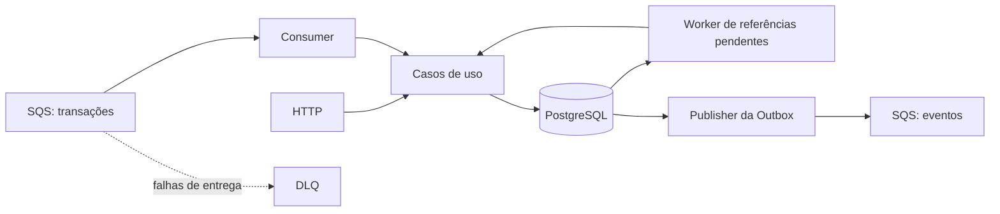

# Arquitetura

O projeto é um monolito modular em NestJS, dividido em carteira (wallet), apostas (wagering) e mensageria (messaging). O Docker Compose sobe três instâncias da mesma aplicação, compartilhando PostgreSQL e as filas SQS do LocalStack.

Este documento reúne as decisões técnicas e as limitações da implementação atual.

## Visão geral

Cada instância contém a API e os três workers: consumo de mensagens, publicação da Outbox e resolução de referências pendentes.

### API e workers no mesmo processo

Mantive API e workers juntos para simplificar a execução e o deploy dentro do prazo do desafio. Não era necessário criar aplicações ou pipelines separados para demonstrar o processamento distribuído.

O custo dessa escolha é a API e workers compartilham recursos, reiniciam juntos e não escalam separadamente nessa configuração. Se um deles exigir mais capacidade, subir outra instância também replica os demais.

A coordenação entre instâncias fica no PostgreSQL (row lock).

### Organização do código

- **Wallet:** abertura de carteira, saldo, extrato e reconciliação.
- **Wagering:** regras e processamento de BET, WIN, LOSS, REFUND e ROLLBACK.
- **Messaging:** consumo SQS, publicação de eventos e referências pendentes.
- **Health:** liveness, readiness e métricas.

Dentro dos módulos, controllers recebem as requisições HTTP, casos de uso coordenam as operações e classes de domínio aplicam as regras. Os adapters fazem o acesso ao banco e ao SQS.

Os casos de uso recebem interfaces para essas dependências. Os arquivos `.providers.ts` fazem a composição com as implementações concretas. Entidades de domínio não possuem decorators de NestJS ou TypeORM, as entidades de persistência (TypeORM) são separadas e convertidas por mappers para entidades de domínio.

Separei as entidades para manter as regras de negócio independentes do TypeORM. O ORM carrega sua representação dos dados e o mapper chama `rehydrate` para reconstruir o objeto de domínio, sem repetir uma operação de negócio. O TypeORM não exige essa separação (poderia ter deixado os decorators na entidade de domínio) mas aceitei o custo dos mappers para evitar esse acoplamento.

## Stack e persistência

### TypeORM e Liquibase

Uso TypeORM e Liquibase no trabalho diariamente. Com três dias para desenvolver o projeto, preferi dedicar o tempo às regras financeiras, concorrência e recuperação de falhas. Não tenho familiaridade com MikroORM e não quis acrescentar esse risco durante o desafio.

TypeORM era uma das opções aceitas no enunciado. Preferi não usar a solução de migrations do TypeORM porque considero que dificulta a leitura e manutenção do banco. O Liquibase executa as migrations SQL versionadas e com rollback explícito.

No Compose, as aplicações só iniciam depois que as migrations e a criação das filas terminam com sucesso. O usuário da aplicação tem permissões diferentes das do usuário de migrations.

## Dinheiro e concorrência

### Representação de dinheiro

Escolhi strings nos requests para que o valor chegue sem perder centavos por conversão para ponto flutuante. Nas respostas, o valor também é uma string decimal.

Para as operações aritméticas, usei `decimal.js` e no PostgreSQL, `NUMERIC`, que preserva a precisão no armazenamento. A classe Money é imutável e o fluxo não converte dinheiro para `number`, como solicitado.

O limite de cada valor monetário acompanha o `NUMERIC(20,2)`: até `999999999999999999.99`, com 18 dígitos inteiros e duas casas decimais. A entrada com mais de duas casas é rejeitada antes da persistência, porque o PostgreSQL arredonda esse valor ao convertê-lo para a coluna. A configuração da aplicação permite BRL e o objeto Money suporta outras moedas, sem realizar conversão cambial, mas isso precisa ser refletido no schema do banco para funcionar.

As classes de domínio possuem factories para criação e `rehydrate` para reconstruir dados persistidos sem executar a operação novamente.

### Lock pessimista por carteira

O desafio testa operações concorrentes sobre a mesma carteira. Escolhi lock pessimista para manter uma sequência simples:

**Obter o lock → ler o saldo atual → aplicar a operação → confirmar a transação.**

Carteiras diferentes podem continuar sendo processadas em paralelo, porque o lock é por linha do banco (row lock).

Lock otimista também seria uma opção (usando o version da wallet, como sugerido no enunciado), especialmente com conflitos raros. Quando há conflito, uma operação precisa recarregar o estado e tentar novamente. O pessimista evita repetir trabalho por esse motivo, mas ainda pode precisar de retries por deadlock ou timeout.

A escolha foi pela simplicidade e pelos cenários de disputa previstos no desafio. Não fiz um benchmark comparando as estratégias. O custo é a espera entre operações da mesma carteira, por isso a transação precisa ser curta e ter timeouts limitados.

### Transações atômicas

Carteira, transação de aposta, ledger e Outbox são gravados na mesma transação SQL. Quando aplicável, Inbox e trabalho de referência pendente também participam dela. Todos usam o mesmo EntityManager daquela transação.

- Uma falha antes do commit desfaz as alterações.
- Um retry de banco reinicia a transação inteira com estado novo.
- A publicação no SQS e o acknowledgment da mensagem recebida acontecem depois do commit.
- Constraints, índices, permissões e triggers protegem os registros no banco.

A igualdade entre saldo e soma do ledger (auditado na reconciliação) depende também desse protocolo de escrita, já que um `CHECK` de linha no banco não compara tabelas. A reconciliação calcula a diferença e a informa, sem corrigir o saldo automaticamente.

## Mensageria e recuperação

HTTP, SQS e retomada de referências pendentes usam o mesmo caso de uso de processamento de apostas.

### Idempotência e Inbox

A chave de idempotência, o hash dos dados de negócio e o resultado ficam persistidos. Repetir a mesma operação devolve o resultado salvo da primeira operação que ficou salva, e reutilizar a chave com dados diferentes gera conflito e retorna erro.

A Inbox deduplica mensagens pelo consumidor e pelo `messageId` do envelope. Isso permite receber novamente uma mensagem cujo processamento foi confirmado antes de o processo conseguir enviar um ack para a fila.

#### Como o hash é calculado

HTTP e SQS validam os dados e normalizam o valor monetário para duas casas antes de calcular o hash. A função `canonicalHash`, em `src/shared/utils/hash.util.ts`, ordena recursivamente as chaves dos objetos, mantém a ordem dos arrays e serializa com `JSON.stringify`. Sobre esse JSON em UTF-8, calcula SHA-256 e salva o resultado hexadecimal.

Entram no hash:

- `providerId`, `externalTransactionId`, `playerId` e `walletId`.
- `roundId`, `gameId` e `kind`.
- `money.amount` e `money.currency`.
- `referenceExternalTransactionId`, quando informado.

A chave de idempotência e os metadados de transporte, como `messageId`, `occurredAt` e `correlationId`, ficam de fora. Assim, mudar a ordem das propriedades ou reenviar a operação por outro canal não muda o hash. Campos desconhecidos e referência com valor `null` são rejeitados na validação.

### Outbox

O evento é salvo junto com a operação financeira. Outro fluxo reserva o registro do evento para processar, publica no SQS e marca o evento como publicado.

Se o processo morrer depois do envio e antes da marcação, o evento pode ser publicado novamente com o mesmo ID. A entrega é pelo menos uma vez (at-least-once), e é responsabilidade do consumidor deduplicar.

A publicação é assíncrona: existe um intervalo entre o commit financeiro e a chegada do evento ao consumidor. Essa propagação posterior é a parte de consistência eventual; a gravação financeira no PostgreSQL continua atômica.

### Referências pendentes

Quando uma referência necessária ainda não chegou, a operação fica pendente e um worker tenta resolvê-la depois. Tentativas, prazos e reservas de trabalho são persistidos para que outra instância possa pegar o trabalho caso a primeira falhe.

Escolhi até 10 tentativas ou 5 minutos, o que ocorrer primeiro, para demonstrar a resolução e a expiração sem precisar esperar muito. O intervalo entre tentativas cresce exponencialmente de 1 segundo até o teto de 30 segundos e o limite de tentativas pode ser atingido antes dos 5 minutos.

Esses valores são configuráveis e foram escolhidos para a demonstração. Em produção, seria necessário revê-los conforme os atrasos esperados e os acordos com cada provedor. Um prazo curto demais pode encerrar uma operação antes de sua referência chegar.

Mensagens com falhas de entrega repetidas podem seguir para a DLQ. Uma referência pendente já aceita no banco é acompanhada pelo worker de referências, sem depender de manter a mensagem original na fila.

### Estados da transação

As transições são implementadas em `WagerTransaction`, em `src/modules/wagering/domain/wager-transaction.domain.ts`.

| Estado atual | Próximos estados permitidos |
| --- | --- |
| `PENDING` | `PENDING_REFERENCE`, `PROCESSED`, `REJECTED` ou `FAILED`. |
| `PENDING_REFERENCE` | Continua pendente em uma nova avaliação, ou passa para `PROCESSED`, `REJECTED` ou `FAILED`. |
| `PROCESSED`, `REJECTED` ou `FAILED` | Nenhuma transição; são terminais. |

Tentar alterar um estado terminal gera `INVALID_TRANSACTION_STATE`. Replay consulta o resultado persistido sem executar uma nova transição.

O domínio possui o método `fail`, mas o fluxo atual da aplicação não o chama. Falhas transitórias seguem o tratamento de retry, sem transformar a operação automaticamente em `FAILED`.

### Códigos de falha

Rejeições persistidas retornam `failureCode`, sem alterar o saldo ou gerar ledger. Os códigos são definidos em `src/shared/enums/wager.enum.ts` e suas mensagens ficam em `src/shared/errors/errors.constant.ts`.

| `failureCode` de rejeição | Significado |
| --- | --- |
| `INSUFFICIENT_FUNDS` | Saldo insuficiente para o débito de uma aposta. |
| `REVERSAL_INSUFFICIENT_FUNDS` | A reversão deixaria o saldo negativo. |
| `MONEY_OVERFLOW` | O resultado ultrapassaria o limite monetário. |
| `CURRENCY_MISMATCH` | As moedas da operação e da carteira não coincidem. |
| `REFERENCE_CONTEXT_MISMATCH` | A referência pertence a outro provider, jogador, carteira, moeda ou rodada. |
| `INVALID_REFERENCE_KIND` | O tipo da transação referenciada não é permitido para essa operação. |
| `REFERENCE_AMOUNT_MISMATCH` | O valor da reversão difere do valor integral da referência. |
| `REFERENCE_ALREADY_REVERSED` | Já existe uma reversão processada do mesmo tipo para a referência. |
| `REFERENCE_NOT_PROCESSED` | A referência não foi processada com sucesso e não está apenas aguardando processamento. |
| `REFERENCE_NOT_FOUND_EXPIRED` | A referência não foi resolvida dentro do prazo ou limite de tentativas. |

`CURRENCY_MISMATCH` é uma proteção do domínio. No fluxo atual de entrada, uma moeda diferente da carteira é detectada antes, como `INVALID_WALLET_CONTEXT` (`400`), sem persistir uma rejeição financeira.

Nem todo erro é uma rejeição financeira. O mesmo enum também contém códigos de conflito, proteção de estado e um código reservado:

- `IDEMPOTENCY_CONFLICT`: mesma chave com dados de negócio diferentes.
- `EXTERNAL_TRANSACTION_CONFLICT`: mesma identidade provider/transação externa com outra chave de idempotência.
- `INBOX_PAYLOAD_CONFLICT`: mesmo consumidor e ID de envelope com outro hash de negócio; a mensagem segue o tratamento de falha permanente.
- `INVALID_TRANSACTION_STATE`: tentativa de alterar uma transação terminal ou produzir um evento incompatível com seu estado.
- `PERMANENT_PROCESSING_FAILURE`: definido, mas sem emissão no fluxo atual.

Na submissão HTTP, processamento confirmado retorna `200`, pendência `202` e rejeição de negócio `422`. Payload inválido retorna `400`, recurso inexistente `404`, conflitos de identidade `409`, falha transitória de banco `503` e erro inesperado `500`. Erros usam o envelope `{code, message, correlationId}`; resultados de negócio carregam `status` e, quando houver rejeição, `failureCode`.

## Escolhas e limitações

### WIN com referência opcional

O enunciado diz que WIN pode referenciar uma BET, sem tornar essa referência obrigatória. Mantive as duas formas de envio: sem referência, o crédito é processado diretamente e com referência, a BET precisa ser validada e, se ainda não chegou, o WIN fica como `PENDING_REFERENCE`.

Assim, a aplicação respeita o contrato sem exigir um vínculo que o desafio deixou opcional.

### Reversões

O enunciado proíbe reverter a mesma referência duas vezes pelo MESMO tipo de operação. Meu entendimento foi o seguinte: uma BET pode receber um REFUND e também um ROLLBACK, creditando seu valor duas vezes.

Por exemplo: saldo de 100 → BET de 25 → 75 → REFUND → 100 → ROLLBACK da BET → 125.

Essa foi uma escolha para atender ao texto do desafio. Em um sistema real, esse comportamento precisaria ser discutido com a equipe de produto antes da implementação.

### Valores zero

O enunciado não define todos os casos de valor zero. Adotei a seguinte interpretação:

- A carteira pode abrir com saldo zero, sem lançamento de abertura no ledger.
- LOSS aceita valor zero e não altera saldo nem gera ledger, pois registra um resultado sem movimentação financeira.
- BET, WIN, REFUND e ROLLBACK exigem valor positivo.

A intenção é permitir zero onde não há movimentação financeira e evitar operações de débito ou crédito sem valor. LOSS também aceita um valor positivo como informação da operação, mas continua sem efeito no saldo.

### Autenticação

Deixei autenticação de fora por questão de tempo e porque não pontuava no desafio. Priorizei as regras financeiras, concorrência e recuperação de falhas.

O `ChallengeAuthGuard` atual permite as requisições. Ele é um ponto de extensão, não uma implementação de autenticação.

Se fosse necessário adicionar autenticação, a proposta seria usar um provedor externo, como Cognito, Keycloak ou Zitadel:

- O provedor de jogos obtém um access token; entre servidores, pode usar OAuth client credentials.
- A API recebe o token e o guard verifica assinatura, emissor, validade e cliente/escopos esperados.
- A autorização associa o cliente autenticado aos provedores que ele pode representar. O `providerId` recebido no corpo não basta para autorizar a operação.
- Health permanece público. O acesso ao SQS seria controlado por IAM e políticas de fila, mantendo a validação de negócio das mensagens.

Essa integração é uma proposta. Nenhum provedor de identidade foi selecionado ou configurado.

### Ambiente local

O PostgreSQL mantém os dados em um volume. As filas do LocalStack não têm persistência configurada e recriar o broker zera as mensagens, inclusive eventos já marcados como publicados no banco.

## Testes

As suítes existentes incluem os cenários abaixo.

| Área | Cenários nos testes | Onde consultar |
| --- | --- | --- |
| Domínio | Money, carteira, transações, ledger e eventos. | `test/unit/` |
| Integração | PostgreSQL e SQS reais, migrations e rollback, constraints, HTTP, Inbox, Outbox e reconciliação. | `test/integration/` |
| Concorrência | 50 apostas iguais, dois débitos de 80 sobre saldo de 100, carteiras independentes e corridas entre três processos Nest. | `test/concurrency/` |
| Recuperação | Encerramento antes/depois do commit e da publicação, substituição de workers, referências fora de ordem e indisponibilidade de dependências. | `test/recovery/` |

Os testes usam um consumidor de eventos auxiliar com deduplicação persistente para verificar entregas repetidas. Isso não substitui a implementação dessa proteção em um consumidor real.
